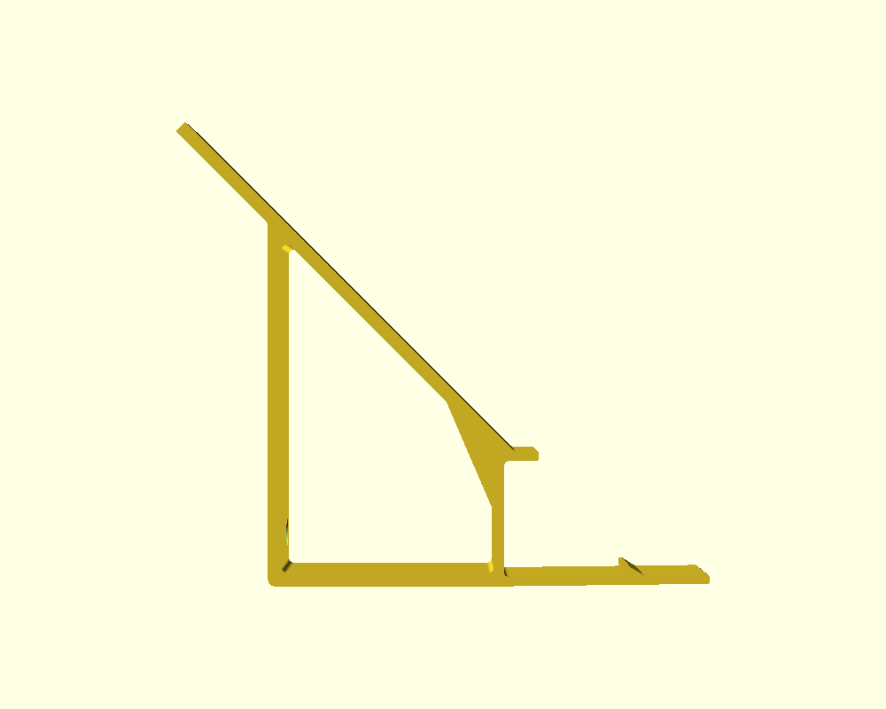

# Clips: the screen on the SMK-37

Two printed clips hold the Guition JC1060P470C (in its black case) on the rear edge of the M-Vave SMK-37,
above the knobs, leaning back 45 degrees. No glue, no tape, no change to the keyboard or the screen.

Each clip has:

- a **jaw** that grips the rear edge of the keyboard: a short tongue on top, a long tongue below;
- a **hook** on the long tongue, which clicks into the recess under the keyboard;
- an **arm** with 2 holes, screwed to 2 of the 4 brass M2 posts on the back of the screen;
- a **foot** and a strut behind the keyboard, which carry the weight of the screen.

The fit was checked with a real print on 2026-11-23.

## Files

| File | What |
| --- | --- |
| `smk37_p4_clip.scad` | the design (OpenSCAD). All sizes are parameters at the top |
| `smk37_p4_clip_A.stl` | clip A. Print 1 |
| `smk37_p4_clip_B.stl` | clip B, the mirror of A. Print 1 |
| `smk37_p4_testfit.stl` | a 10 mm slice, to check the fit on the keyboard before a full print. Its holes are in the middle: do not use it to check the side offset of the holes |
| `preview.png`, `preview_iso.png`, `preview_face.png` | pictures of clip A: side view, 3D view, and the face of the arm with the holes |

A and B are different because the holes are 6 mm from one side edge and 19 mm from the other.

## Print

- Open the STL as it is. It already lies on its side (25 mm high), so the layers follow the shape of the
  jaw and the jaw is strong. No supports.
- The part is about 156 x 136 mm on the plate.
- PETG is the best choice (it flexes). PLA is OK.
- 4 walls, 0.2 mm layers.

## Mount

You need 4 M2 screws.

1. Screw clip A to one pair of posts (one low, one high) and clip B to the other pair. Put the side with
   the holes near the edge toward the outside or the inside of the screen, the same for both. If it does
   not fit, swap A and B.
2. The low screw is behind the strut. Push the screwdriver through the 6 mm hole in the strut.
3. The top hole is a slot. Move the screen up or down a little before you tighten the top screws.
4. Push the two clips on the rear edge of the keyboard, between two knobs, until the hooks click.

To remove: pull the long tongues down a little to free the hooks, then pull the clips to the rear.

## Change a size

Change the parameter at the top of `smk37_p4_clip.scad`, then make the files again. From PowerShell in
this folder (OpenSCAD 2021.01):

    $o = "C:\Program Files (x86)\OpenSCAD\openscad.com"
    & $o -o smk37_p4_clip_A.stl -D part=0 -D side=0 smk37_p4_clip.scad
    & $o -o smk37_p4_clip_B.stl -D part=0 -D side=1 smk37_p4_clip.scad
    & $o -o smk37_p4_testfit.stl -D part=1 smk37_p4_clip.scad
    & $o -o preview.png -D part=0 --imgsize=1000,800 --camera=0,0,0,0,0,0,0 --viewall --autocenter --render smk37_p4_clip.scad

The parameters that matter most:

| Problem | Parameter |
| --- | --- |
| The jaw is loose or tight on the keyboard | `kb_rear_h` (the opening), `pinch` (the spring) |
| The hook does not click, or the clip does not go on | `hook_x` (where), `hook_h` (how high) |
| The top tongue touches a knob | `kb_top_reach` |
| The screen is too upright or too flat | `tilt` |
| The screen touches the knobs | `lift` |
| The top hole does not reach the post | `post_gap_min`, `post_gap_max` |
| The foot does not touch the table | `foot_drop` |

Print `smk37_p4_testfit.stl` first after a change to the jaw or the hook.

## Sizes

Measured on the real parts: the keyboard body is 34.5 mm high at the rear; the top is free for 3 mm from
the rear edge, then the knobs start; the rear face is flat; the recess under the keyboard starts about
35 mm from the rear edge; the posts on the screen have an M2 thread.

Not measured: the distance between the low and the high post (the slot covers 93 to 101 mm, and it fits).
